# Clearline Dental

**Online booking and front-desk dashboard for a dental clinic.** A Django REST API and a React
SPA, deployed to production with CI, end-to-end tests and an animated, fast public site.

[](https://github.com/RenzzoGG/clearline-dental/actions/workflows/ci.yml)
&nbsp;**Live demo → [clearline.renzzogg.com](https://clearline.renzzogg.com)**

> Clearline is a fictional clinic, built as a portfolio project. No real appointments are made.

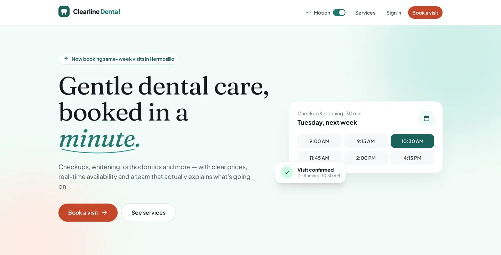

## Try the demo

Open [the login page](https://clearline.renzzogg.com/login) and use one of the public demo
accounts. Their passwords are shown right there under **"Try the demo"**.

| Role | Account | What to try |
|------|---------|-------------|
| Front desk | `demo-reception` | Week/day schedule, confirm or cancel visits, insights |
| Patient | `demo.patient@clearline.test` | Book a visit as a signed-in patient |

Demo data **resets every night** (02:00, America/Hermosillo), so feel free to click around.

## Screenshots

| Availability picker | Booking confirmed |
|---|---|
| 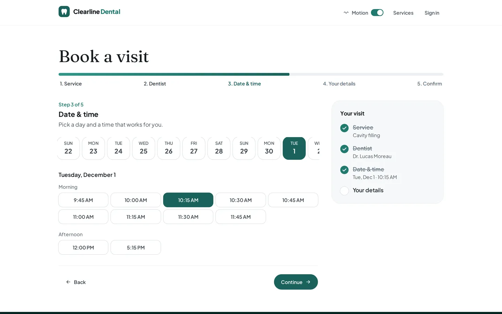 | 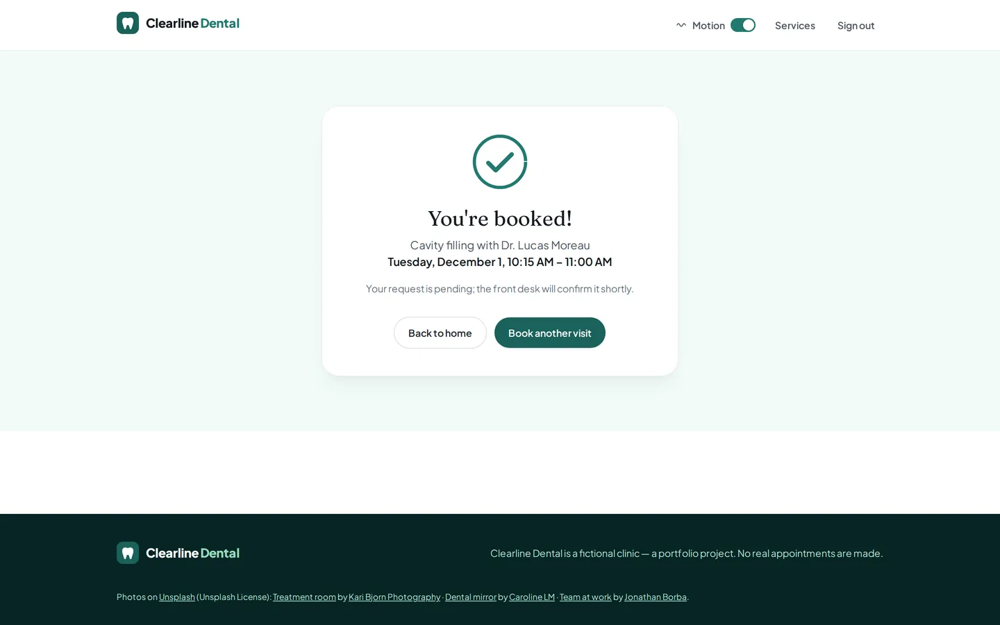 |
| **Front desk schedule** | **Insights** |
| 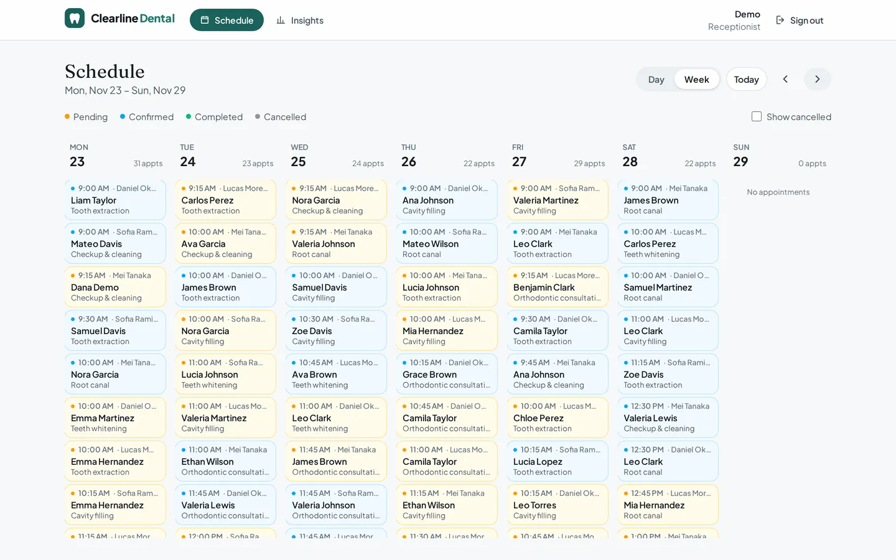 | 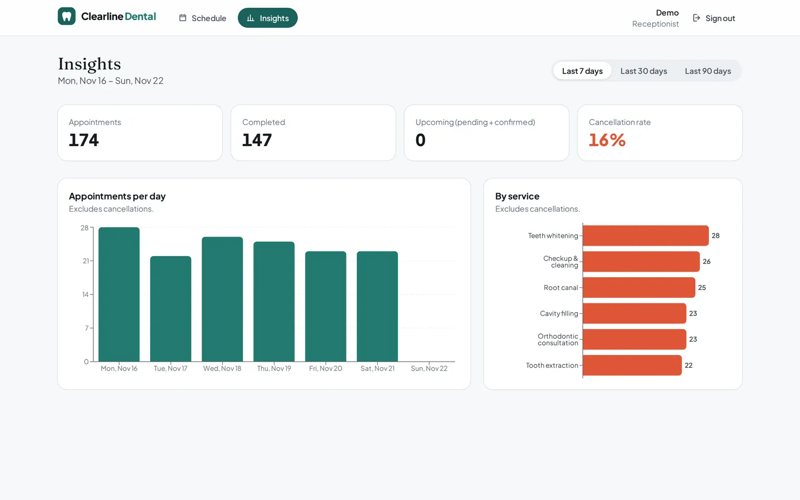 |

| Mobile: landing | Mobile: booking | Mobile: front desk |
|---|---|---|
| 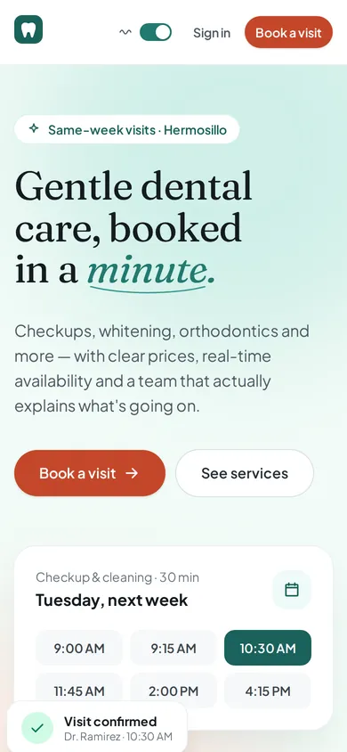 | 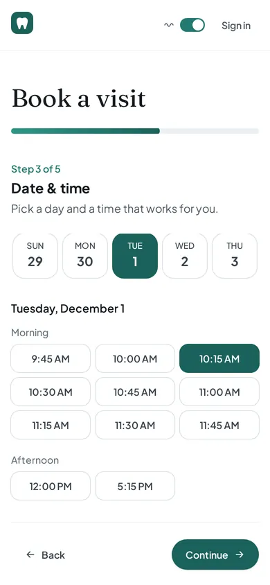 | 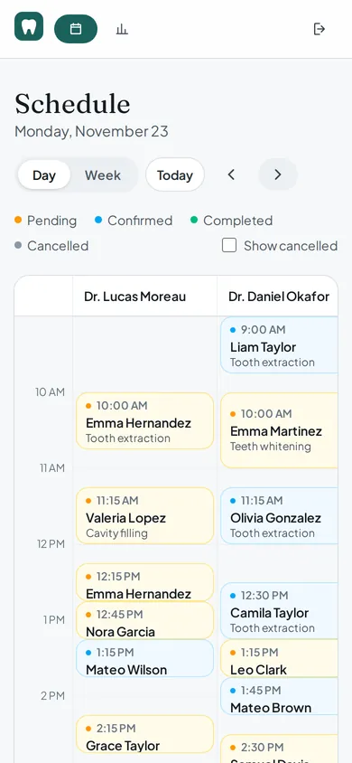 |

<details>
<summary>More screenshots (booking steps, signed-in patient, API docs)</summary>

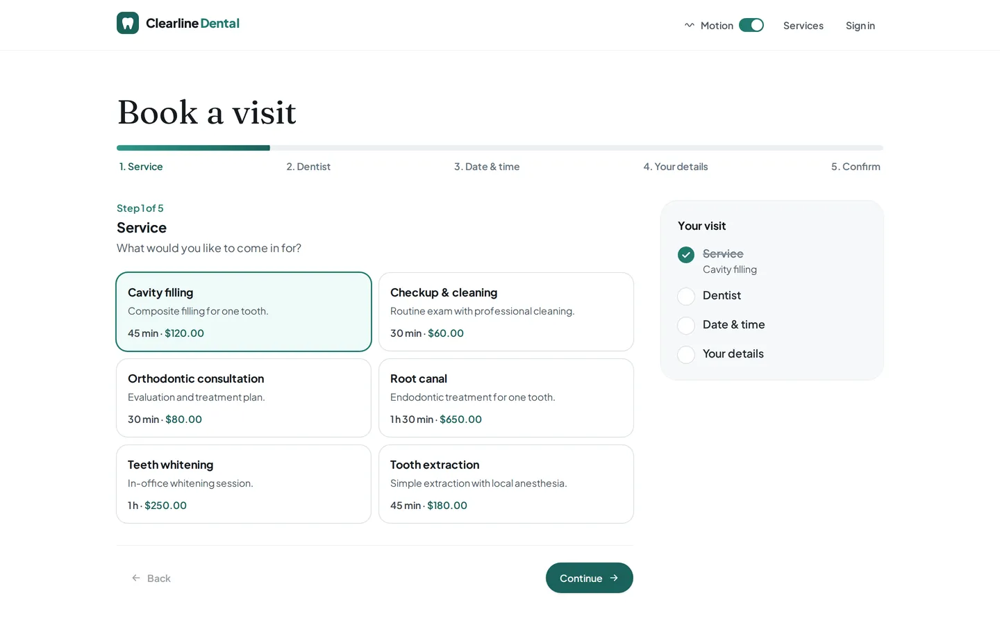
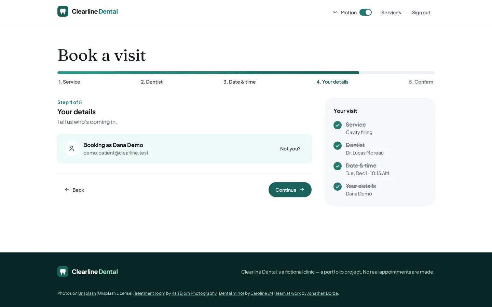
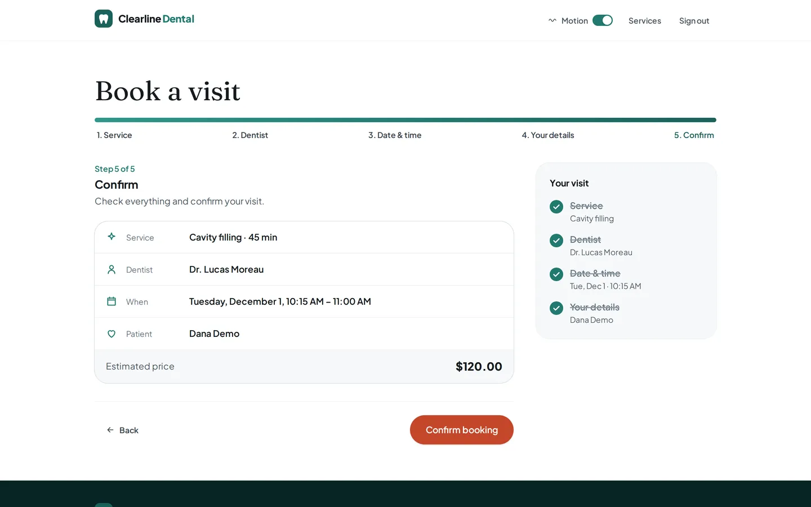
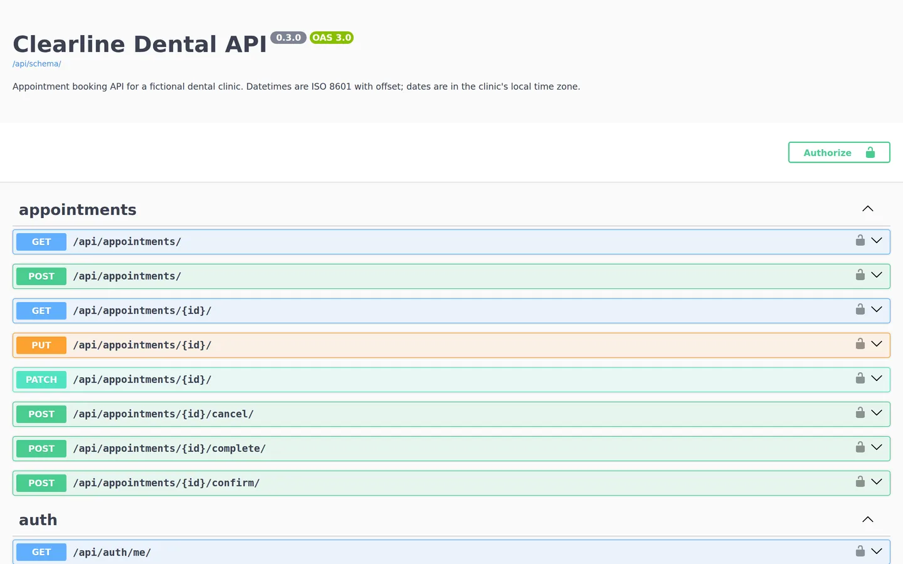

</details>

## Features by role

**Patient (or visitor)**
- Book a visit in five steps (service → dentist → date and time → details → confirm), with live availability.
- Create an account during booking, or sign in and book as yourself ("Booking as …").
- Clear prices and durations up front.

**Receptionist (front desk)**
- Week and day schedule per dentist, color-coded by status.
- Confirm, complete or cancel appointments from a side drawer.
- Insights for the last 7, 30 or 90 days: appointments per day and by service, completed and upcoming visits, and cancellation rate.

**Admin**
- Everything the front desk can do, plus managing dentists, services and patients through the API.
- Django admin at `/admin/` for back-office data and user roles.

## Architecture

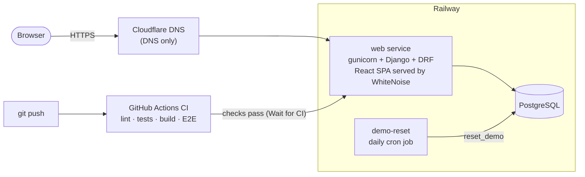

One container serves the API, the admin and the built SPA from the same origin, so there's no
CORS and no extra proxy service. The `demo-reset` job reuses the same image.

## Engineering decisions

- **Overlap-proof bookings in the database.** A Postgres `ExclusionConstraint` on
  `(dentist, tstzrange(starts_at, ends_at))` makes double-booking impossible, even when two
  requests race past application validation at the same moment.
- **One clinic time zone.** `TIME_ZONE = "America/Hermosillo"` (UTC−7 all year, no DST). The
  API speaks ISO 8601 with offsets, and date filters use the clinic's local day.
- **Explicit status machine.** `pending → confirmed → completed`, and `pending/confirmed →
  cancelled`. Invalid transitions return **409 Conflict**, and completing a visit before it starts is rejected.
- **JWT with rotation and blacklist.** 15-minute access tokens and 7-day refresh tokens. Every
  refresh rotates the token and blacklists the old one, and logout blacklists it too.
- **Rate limiting that works behind the proxy.** Throttles for login, sign-up, refresh, booking
  and availability are keyed on the `X-Real-IP` header Railway's edge sets. `X-Forwarded-For`
  made every attempt look like a new client.
- **Single canonical domain.** Only `clearline.renzzogg.com` is in `ALLOWED_HOSTS`, so the
  `*.up.railway.app` host gets a 400 on purpose (no duplicate content, one origin for HSTS and cookies).
- **Performance budgets in CI.** Motion's animation features load asynchronously, below-the-fold
  sections are a deferred chunk, and scroll effects use CSS `animation-timeline`. CI fails
  if critical JS exceeds 110 KB gzipped (it's ~107 KB) or any route chunk exceeds its budget.
  Every animation respects `prefers-reduced-motion`, and there's a visible Motion toggle.
- **Lighthouse (mobile, live site, 2026-11-21):** Performance 93–97 · Accessibility 100 · Best
  practices 100 · SEO 100. CLS ≈ 0.

## Tech stack

| Layer | Tools |
|-------|-------|
| Backend | Python 3.13, Django 5.2, Django REST Framework, SimpleJWT, drf-spectacular (OpenAPI), django-filter |
| Database | PostgreSQL 17 |
| Frontend | React 19, TypeScript, Vite, Tailwind CSS v4, Motion, TanStack Query, React Hook Form + Zod, Recharts |
| Testing | pytest + factory-boy (98% coverage), Vitest + Testing Library, Playwright |
| Infra | Docker Compose, GitHub Actions, Railway (gunicorn + WhiteNoise), Cloudflare DNS |

## Run it locally

Requirements: Docker with Compose.

```bash
cp .env.example .env              # then replace the changeme placeholders
docker compose up --build         # db, backend (:8000) and frontend (:5173)
# Port 5432 already taken by a local Postgres? Pick another host port:
# POSTGRES_HOST_PORT=5433 docker compose up --build

docker compose exec backend python manage.py seed         # dentists, services, sample visits
# Optional, public-demo mode: re-seeds and creates the demo accounts
# (needs DEMO_MODE=True and the two DEMO_*_PASSWORD values in .env)
docker compose exec backend python manage.py reset_demo
```

- Site: http://localhost:5173
- API docs (Swagger): http://localhost:8000/api/docs/
- Django admin: http://localhost:8000/admin/ (create a user with `python manage.py createsuperuser`)

## Tests

```bash
# Backend: lint + tests with coverage (CI requires ≥ 85%)
docker compose exec backend uv run ruff check .
docker compose exec backend uv run pytest --cov=apps --cov=config

# Frontend: lint, types, unit tests, production build and size budgets
docker compose exec frontend npm run lint
docker compose exec frontend npm run typecheck
docker compose exec frontend npm test
docker compose exec frontend npm run build
docker compose exec frontend npm run budgets
```

End-to-end tests (Playwright) run against the production Docker image, exactly as in CI. See
[docs/DEPLOY.md](docs/DEPLOY.md), section 9.

## Docs

Detailed notes (in Spanish) live in [`docs/`](docs/):

- [`PLAN.md`](docs/PLAN.md): phases, architecture and approved dependencies
- [`DEPLOY.md`](docs/DEPLOY.md): CI, production hardening, Railway setup and the post-deploy review
- [`MOTION-PLAN.md`](docs/MOTION-PLAN.md): art direction, animation rules and performance budgets

Screenshots are produced by [`frontend/scripts/capture-screenshots.mjs`](frontend/scripts/capture-screenshots.mjs)
against the live demo. Stock photo credits are in
[`photo-credits.ts`](frontend/src/features/site/photo-credits.ts) and in the site footer.

## Roadmap

- Patient "My appointments" page (view and cancel your own visits)
- n8n chatbot that books through this same API, with its own service role
